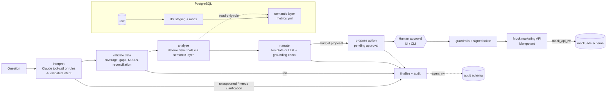

# AI Marketing Performance Agent

Ask a marketing question in plain English. The agent validates the data, runs **deterministic** analyses against a governed
semantic layer, and answers with evidence-cited findings, clearly-labelled hypotheses and honest limitations. When it
recommends a budget change, it can only **propose** it: a human must approve, guardrails must pass, and a signed approval
reaches a (mock) marketing API. Every step is audited.

> **Everything here runs on synthetic data** with planted, documented ground truth, so the evaluation measures whether the
> system recovers *known* causes. Nothing claims performance on real advertising data. See [Limitations](#limitations).

## What it looks like

```text
$ make ask Q="Why did Meta ROAS decline in October compared with September?"

Meta Ads ROAS fell 17.7% (1.90 in Sep 2026 to 1.56 in Oct 2026).
 - Meta | Prospecting | Lookalike 1% is the largest driver: 53% of the change (-0.18 of -0.34). Its own ROAS moved
   1.40 to 1.06 (-24.7%); -0.15 is performance and -0.03 is budget mix. Its spend rose 43%.        [E2]
 - Within that campaign, CTR is the dominant factor: it fell 23.5% (1.21% to 0.93%) and explains 95% of
   the change. Conversion rate was not the problem (+7.4%).                                         [E3]
HYPOTHESES (unverified): creative fatigue or audience saturation; a targeting/frequency change
   (no creative- or frequency-level data in the warehouse, so this cannot be confirmed).
RECOMMENDATIONS: refresh creative / review frequency; consider phasing back the spend increase.
LIMITATIONS: last-click attribution (correlation, not incrementality); 1 campaign-day with NULL clicks; ...
grounding=100%  evidence items=3  (429 ms)
```

```text
$ python -m mpia.agent.cli ask 'How should I allocate a $50,000 marketing budget?'   # proposes, never executes
PROPOSED ACTION ACT-70113E4474 is pending approval.

$ python -m mpia.agent.cli approve ACT-70113E4474 --user intern --role viewer
DENIED: Role 'viewer' is not allowed to approve or reject actions.
$ python -m mpia.agent.cli approve ACT-70113E4474 --user amy --role marketing_manager --edit META_RETARG=118
{"status": "executed", "http_status": 200, "response": {"status": "applied", "campaigns_updated": 10, ...}}
```

## Design principles

1. **The LLM never does math or writes SQL.** It only maps a question to a validated `Intent`; SQL is compiled from the semantic
   layer with whitelisted identifiers. Prompt injection can at worst mis-classify a question.
2. **Every number is traceable.** Findings cite evidence ids (tool, inputs, exact SQL). A grounding check verifies each number in
   generated prose exists in tool output; a failing LLM summary is retried once, then replaced by a deterministic template.
3. **Honest about uncertainty.** Causes are *hypotheses*, not findings. Data-quality warnings, attribution caveats and a bootstrap
   interval travel with the answer. If data is missing, it says so instead of guessing.
4. **Governed actions.** Proposal -> role-checked human decision (with edits) -> guardrails -> HMAC-signed approval bound to the exact
   payload -> mock API that independently verifies it and enforces idempotency.
5. **Evaluated, including against itself.** Calculations are checked against an independent pandas oracle; root causes against
   planted ground truth; interpretation against a held-out set whose first-run score is reported, not buried.

## Architecture



More detail: [`docs/DECISIONS.md`](docs/DECISIONS.md), [`docs/mvp_scope.md`](docs/mvp_scope.md) (which maps each BRD item to code and lists where
this deviates from the BRD), and [`docs/ENGINEERING_LOG.md`](docs/ENGINEERING_LOG.md) (what broke while building it and what changed).

## Quickstart

Requirements: Python 3.11+, PostgreSQL 16 (a `docker-compose.yml` is provided), `make`.

```bash
cp .env.example .env
docker compose up -d --wait          # or point PGHOST/PG_ADMIN_* at your own Postgres
pip install -r requirements.txt
make setup                           # roles/schemas -> synthetic data -> raw -> dbt build -> mock budgets
make test                            # 281 tests
make eval                            # regenerates docs/EVAL_REPORT.md

make api                             # terminal 1: mock marketing API on :8000
make app                             # terminal 2: Streamlit UI on :8501
make ask Q="Where are users dropping off between ad click and purchase?"
# amounts containing "$": call the CLI directly with single quotes (make would expand "$5" itself):
python -m mpia.agent.cli ask 'How should I allocate a $50,000 marketing budget?'
```

No API key is needed: without `ANTHROPIC_API_KEY` the agent runs in deterministic rule-based mode. To use Claude for
interpretation and summaries: `export ANTHROPIC_API_KEY=...` (model via `ANTHROPIC_MODEL`). `python -m evals.run_evals --llm`
evaluates that path.

## Results (details and caveats: [`docs/EVAL_REPORT.md`](docs/EVAL_REPORT.md))

| Check | Result |
|---|---|
| Metric calculations vs independent pandas oracle | 210/210 match (worst relative error 6e-16) |
| Planted root causes recovered (campaign, funnel factor, checkout bug + onset date within 3 days) | 8/8 |
| Funnel false alarms on defect-free months | 1 flag in 30 runs |
| Governance & safety (injection, role checks, forged tokens, guardrails, idempotency, privilege) | 12/12; 0 unauthorised executions |
| Numbers in answers traceable to tool output | 100% across 12 end-to-end questions; p95 latency ~0.55 s (local, rules mode) |
| Interpretation, rules, **held-out phrasings, first run** | **65%** (17/26), every miss a safe refusal |
| Interpretation after one round of fixes | 96% (no longer held-out) |

## MVP scope

All 15 MVP items are implemented; the mapping is in [`docs/mvp_scope.md`](docs/mvp_scope.md).

## Limitations

- **Synthetic data only.** Real data brings messier attribution, tracking and noise. The system's *methods* are general; its
  *measured performance* is not.
- **A workflow agent, not an open-ended one.** Five intents with fixed tool plans; anything else gets a polite refusal.
- **The LLM path has not been run against the live API** in the environment this was built in. It is covered by stubbed tests
  (schema, fallback, injection handling) and the deterministic path is fully evaluated. Run `--llm` with your key.
- **Budget uplift is a model, not a forecast.** Diminishing-returns curves fitted on last-click history with a bootstrap
  interval; no incrementality testing. Brand search is held flat by policy; retargeting scale-up is flagged as audience-limited.
- **Time-saved vs a manual analyst is not measured** ([`docs/manual_baseline.md`](docs/manual_baseline.md) is a protocol for doing so).
- **Chronic funnel defects present in both periods are not flagged** (the tool detects *changes* that are also worse than comparable traffic).
- The approval token is signed with a shared secret; in production the signer would be a separate service or identity provider.
- `docker-compose.yml` and `.github/workflows/ci.yml` mirror the verified local setup but were not themselves executed.

## Repo layout

```
mpia/datagen/   synthetic data + ground truth        mpia/tools/     validation, KPI, drivers, funnel, campaigns, budget
mpia/semantic/  metrics.yml, registry, warehouse     mpia/agent/     intents, interpreter, analysis, grounding, graph, CLI
mpia/actions/   approval service, guardrails, mock API   mpia/audit/  audit logger     mpia/app/  Streamlit UI
dbt_project/    staging + marts + data tests         sql/init/       schemas, roles, audit + mock-API tables
tests/          281 tests                            evals/          benchmark, oracle, harness      docs/  reports + design
```
