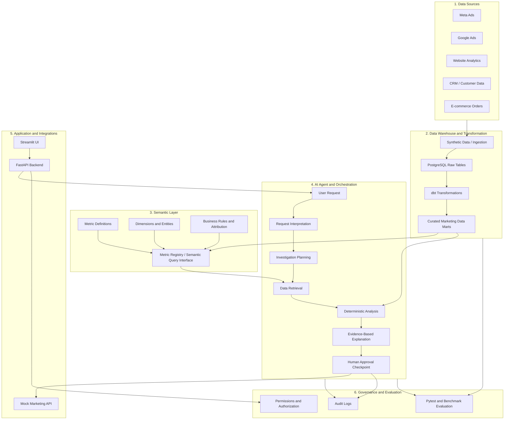

# System Architecture
## Marketing Performance Intelligence Agent

## 1. Architecture Overview

The application consists of six logical layers:

1. Data source and ingestion layer.
2. Data warehouse and transformation layer.
3. Semantic layer.
4. AI agent and orchestration layer.
5. Application and integration layer.
6. Governance and evaluation layer.

### Architecture Diagram



## 2. Technology Stack

| Component | Technology | Responsibility |
|---|---|---|
| Database | PostgreSQL | Store marketing data |
| Transformation | dbt Core | Clean and transform data |
| Semantic layer | dbt metric definitions / MetricFlow-compatible design | Centralize metrics and business definitions |
| Programming | Python | Analytics and application logic |
| LLM | OpenAI API | Understand requests and explain findings |
| Orchestration | LangGraph | Manage agent state and workflow |
| Tool calling | OpenAI function calling | Let the LLM invoke application tools |
| Backend | FastAPI | Application API |
| Frontend | Streamlit | User interface |
| Validation | Pydantic | Validate structured inputs and outputs |
| Testing | Pytest | Unit and integration testing |
| Deployment | Docker | Reproducible environment |
| Version control | Git/GitHub | Source control |

## 3. Data Architecture

### 3.1 Data Ingestion

For the MVP, generate synthetic data representing:

- Advertising performance.
- Campaign metadata.
- Website analytics.
- E-commerce orders.
- Customer acquisition.

The ingestion process loads the data into PostgreSQL raw/source tables.

Future versions may replace synthetic sources with actual platform APIs.

### 3.2 Warehouse Data Model

Fact tables:

**fact_ad_performance**

Grain: one row per date, platform and ad.

Fields:
- date_id
- platform_id
- campaign_id
- ad_id
- spend
- impressions
- clicks
- platform_reported_conversions
- platform_reported_revenue

**fact_web_analytics**

Grain: one row per date, campaign and landing page.

Fields:
- date_id
- campaign_id
- landing_page_id
- sessions
- engaged_sessions
- add_to_carts
- purchases

**fact_orders**

Grain: one row per order.

Fields:
- order_id
- customer_id
- order_date
- order_revenue
- discount_amount
- refund_amount
- campaign_id (when a defensible attribution mapping is available)

**fact_customer_acquisition**

Grain: one row per acquired customer.

Fields:
- customer_id
- acquisition_date
- first_touch_channel
- acquisition_campaign_id
- new_customer_flag

Dimension tables:

- dim_date
- dim_platform
- dim_channel
- dim_campaign
- dim_ad
- dim_landing_page
- dim_customer

### 3.3 dbt Transformation Layers

**Staging**

Purpose: Standardize source data.

Models:
- stg_meta_ads
- stg_google_ads
- stg_web_analytics
- stg_orders
- stg_customers

**Intermediate**

Purpose: Apply reusable business logic and combine related data.

Models:
- int_campaign_performance
- int_order_attribution
- int_customer_acquisition
- int_conversion_funnel

**Marts**

Purpose: Provide clean analytical datasets.

Models:
- fct_marketing_performance_daily
- fct_campaign_performance
- fct_customer_acquisition
- fct_conversion_funnel

Dimension models:
- dim_campaign
- dim_channel
- dim_platform
- dim_date

All models must have documented grains, relationships and appropriate uniqueness, not-null and relationship tests.

## 4. Semantic Layer Architecture

The semantic layer sits between the curated dbt marts and the agent's analytical tools.

It is responsible for defining what business metrics mean and how they can be queried consistently.

### Semantic entities

Examples:
- Campaign
- Platform
- Channel
- Date
- Customer
- Landing Page

### Semantic dimensions

Examples:
- Campaign name
- Campaign objective
- Platform
- Channel
- Date
- Geography
- Audience segment

### Semantic metrics

| Metric | Formula |
|---|---|
| Ad Spend | SUM(spend) |
| Impressions | SUM(impressions) |
| Clicks | SUM(clicks) |
| CTR | SUM(clicks) / SUM(impressions) |
| CPC | SUM(spend) / SUM(clicks) |
| CPA | SUM(spend) / SUM(conversions) |
| ROAS | SUM(attributed revenue) / SUM(ad spend) |
| CAC | Acquisition costs / new customers acquired |
| Conversion Rate | Conversions / defined eligible population |

Ratios must be calculated from aggregated numerators and denominators, not by taking a simple average of row-level ratios.

The application must distinguish:
- Platform-reported conversions.
- Website analytics purchases.
- Canonical e-commerce orders.
- Attributed revenue.
- Total realized order revenue.

These are different measures and must not be substituted for one another without an explicit business rule.

### Semantic implementation for the MVP

Use:
1. dbt models as the governed analytical foundation.
2. YAML or equivalent metadata to document metrics, entities, dimensions and definitions.
3. A Python metric registry that loads approved metric metadata.
4. Validated SQL templates or an approved semantic query interface to retrieve metrics.

Evaluate MetricFlow as the query engine for the semantic models. If the selected deployment requires dbt Cloud or additional infrastructure, keep the MVP's metric registry and validated query layer independent so the project is not blocked.

The LLM must never create new metric definitions.

### Example metric contract

```yaml
name: roas
label: Return on Ad Spend
description: Attributed revenue divided by advertising spend
numerator: attributed_revenue
denominator: ad_spend
aggregation: ratio_of_sums
supported_dimensions:
  - date
  - platform
  - channel
  - campaign
attribution_model: configured_model
zero_denominator_behavior: null
```

## 5. AI Agent Architecture

### 5.1 Agent responsibilities

The LLM is responsible for:
- Understanding natural-language questions.
- Identifying the requested KPI and dimensions.
- Planning the investigation.
- Selecting approved analytical tools.
- Interpreting analytical results.
- Producing explanations and recommendations.

The LLM is not responsible for:
- Performing arithmetic.
- Defining business metrics.
- Inventing data.
- Bypassing data validation.
- Executing unauthorized actions.

### 5.2 LangGraph workflow

Nodes:

1. interpret_request
2. validate_request
3. resolve_metrics
4. plan_investigation
5. retrieve_data
6. validate_data
7. run_analysis
8. generate_findings
9. generate_recommendation
10. approval_checkpoint
11. execute_action
12. record_audit

Conditional routes:

- Missing essential request details → clarification.
- Invalid metric → explain unsupported metric.
- Data validation failure → stop or retry safely.
- Retrieval failure → bounded retry, then report failure.
- No evidence → state that the cause cannot be determined.
- Recommendation rejected → terminate without execution.
- Recommendation approved → verify authorization and execute.

### 5.3 Shared agent state

The LangGraph state should contain:

- request_id
- user_id
- original_question
- interpreted_request
- metric_definitions
- filters
- date_range
- investigation_plan
- retrieved_data_references
- validation_results
- analytical_results
- evidence
- recommendation
- approval_status
- execution_status
- errors
- audit_metadata

Avoid putting unrestricted raw customer data or secrets into the LLM context.

## 6. Analytical Tool Architecture

Implement deterministic Python functions:

**Metric tools**
- get_metric_definition
- get_available_dimensions

**Data retrieval tools**
- query_marketing_performance
- query_campaign_performance
- query_conversion_funnel

**Analysis tools**
- calculate_kpi_changes
- compare_periods
- analyze_campaign_drivers
- analyze_channel_performance
- analyze_conversion_funnel

**Recommendation tools**
- recommend_budget_allocation
- create_budget_change_proposal

**Action tools**
- execute_approved_budget_change

Each function must have:
- Typed inputs.
- Input validation.
- Explicit output schema.
- Error handling.
- Logging.
- Unit tests.

The SQL query layer must use approved models and allowlisted dimensions and filters. Do not expose unrestricted database execution to the LLM.

## 7. Application Architecture

### Frontend: Streamlit

Main screens:

1. Marketing Intelligence Chat.
2. Investigation Report.
3. Campaign Performance Dashboard.
4. Recommendation and Approval Center.
5. Audit and Investigation History.

### Backend: FastAPI

Responsibilities:
- Accept user requests.
- Manage user sessions and permissions.
- Invoke LangGraph.
- Return structured investigation results.
- Store recommendations and approval records.
- Manage action execution.

### Mock Marketing API

The mock API simulates:
- Campaign budget updates.
- Campaign status changes.
- Execution responses.
- Duplicate request prevention.

It must reject requests without a verified approval record and authorized user.

## 8. Governance and Audit

Maintain records for:

- Original user request.
- Interpreted request.
- Metric definitions used.
- Data sources and filters.
- Tool calls and outputs or secure references.
- Validation results.
- Generated findings.
- Recommendation versions.
- Approval identity and timestamp.
- Execution request and response.

Use read-only database credentials for analytics. Use a separate controlled interface for mock actions.

Approval must be bound to the exact recommendation version and proposed action parameters. Editing a proposal invalidates the previous approval.

## 9. Evaluation Architecture

Build a benchmark of 30–50 business questions.

Categories:
- Request interpretation.
- Metric resolution.
- Data retrieval.
- Numerical calculation.
- Driver analysis.
- Recommendation grounding.
- Error handling.
- Approval enforcement.

Evaluate:
- Intent accuracy.
- Tool selection accuracy.
- Retrieval success.
- Calculation accuracy.
- Evidence grounding.
- Workflow completion.
- Action authorization.
- Latency and cost.

Compare manual and agent-assisted investigation times using identical benchmark questions.

## 10. Key Architecture Decisions

**ADR-001: PostgreSQL**

Decision: Use PostgreSQL as the MVP warehouse.

Reason: Simple local development, relational modeling and SQL access.

**ADR-002: dbt**

Decision: Use dbt Core for transformation and testing.

Reason: Demonstrates analytics engineering and maintainable transformation logic.

**ADR-003: Semantic layer**

Decision: Centralize metric definitions in a governed semantic model/registry, with MetricFlow evaluated as the query engine.

Reason: Prevents inconsistent metric calculations and keeps business definitions separate from LLM prompts.

**ADR-004: LangGraph**

Decision: Use LangGraph for agent workflow orchestration.

Reason: Explicit state, conditional execution, retry handling and human approval checkpoints.

**ADR-005: OpenAI function calling**

Decision: Use function calling to expose approved application tools to the model.

Reason: Structured interaction between the LLM and deterministic business logic.

**ADR-006: Single agent first**

Decision: Build one orchestrated agent with multiple tools instead of multiple specialized agents.

Reason: Lower complexity, easier testing and clearer responsibility boundaries.

**ADR-007: Human approval**

Decision: Require explicit approval for external actions.

Reason: Prevent autonomous changes to marketing budgets without business authorization.

**ADR-008: Synthetic data**

Decision: Generate synthetic marketing data for the MVP.

Reason: Avoids dependence on external accounts, credentials and proprietary data.

## 11. Deployment Architecture

Local development:

```text
Docker Compose
  ├── PostgreSQL
  ├── FastAPI
  └── Streamlit
```

Python dependencies:
- LangGraph
- OpenAI SDK
- dbt-postgres
- pandas
- Pydantic
- SQLAlchemy
- FastAPI
- Streamlit
- pytest

The LLM API key must be stored in a local environment file excluded from Git.

The application must include a README with setup, data generation, database initialization, dbt execution, testing and launch instructions.